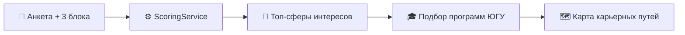

<div align="center">

  

  <h1>🎓 Карьерная траектория ЮГУ</h1>

  <p>
    <strong>Найди профессию, которая подходит именно тебе.</strong><br/>
    Веб-сервис профориентационной диагностики и построения образовательного маршрута в Югорском государственном университете и его филиалах.
  </p>

  <p>
    
    
    
    
    
  </p>

</div>

---

## 📊 Проект в цифрах

| 📚 Программы | 🏛 Учреждения ХМАО | 💼 Профессии | ❓ Вопросы / Ответы | 🧠 Категории | 🗺️ Маршруты |
| :---: | :---: | :---: | :---: | :---: | :---: |
| **105** | **6** | **185** | **35 / 176** | **25** (9 сфер) | **72** |

---

## ⚡ Как это работает



1. **Диагностика (~35 минут):** пользователь заполняет анкету и проходит 3 тестовых блока — *«Склонности в деятельности»*, *«Тип интеллекта» (по Гарднеру)* и *«Жизненные ценности»*.
2. **Умный расчёт (`ScoringService`):** каждый ответ начисляет баллы по категориям, система определяет ведущие сферы интересов и сопоставляет их с уровнем образования и параметрами анкеты.
3. **Карта карьерных путей:** пользователь получает готовый маршрут — **стартовая позиция → подходящая программа → следующий шаг (например, магистратура) → конкретные профессии**.

---

## ✨ Возможности сервиса

### 👤 Для абитуриента и студента
* **Личный кабинет и прогресс:** сохранение сессий тестирования, возможность вернуться к блокам и пересчитать результаты после обновления анкеты.
* **Наглядные результаты:** рейтинг ключевых сфер интересов и визуальная карта образовательных траекторий.
* **База ЮГУ и филиалов:** программы головного вуза (Ханты-Мансийск), Многопрофильного колледжа и филиалов (Сургут, Нефтеюганск, Нижневартовск, Лянтор).

### 🛠 Панель администратора
* **Полный CRUD без правки кода:** управление вопросами, вариантами ответов, баллами по категориям, программами, профессиями и учреждениями.
* **Аналитика:** просмотр прохождений диагностики и результатов пользователей.
* **Безопасное удаление:** проверка зависимостей перед удалением связанных сущностей, чтобы не нарушить работу алгоритма рекомендаций.

---

## 🚀 Быстрый старт

```bash
# 1. Клонируйте репозиторий
git clone [https://github.com/Useraaa221105/career-guidance-yugu.git](https://github.com/Useraaa221105/career-guidance-yugu.git)
cd career-guidance-yugu

# 2. Установите зависимости
composer install
npm install

# 3. Настройте окружение и ключ приложения
cp .env.example .env
php artisan key:generate

# 4. Создайте БД и заполните справочники
php artisan migrate --seed

# 5. Соберите фронтенд и запустите сервер
npm run build
php artisan serve
```

После запуска сервис откроется по адресу `http://127.0.0.1:8000`.

---

## 📁 Архитектура проекта

<details>
<summary><b>Развернуть структуру папок</b></summary>

* `app/Http/Controllers/` — контроллеры тестирования (`TestController`), админ-панели (`AdminController`), профиля и авторизации (`Laravel Breeze`).
* `app/Services/ScoringService.php` — ядро алгоритма: подсчёт баллов, топ-сферы, ранжирование программ и сборка карьерной карты.
* `app/Models/` — модели БД (`Question`, `Answer`, `TestBlock`, `TestSession`, `Category`, `Program`, `Profession`, `Institution`, `School`).
* `database/seeders/` — сидеры для наполнения базы вопросами, программами и описаниями.
* `info_edu/` и `docs/` — исходные данные по программам ЮГУ и спецификация (`master-data-spec.md`).

</details>

---

## 👨‍💻 Автор

**akhmatkulov_005** — Инженерная школа цифровых технологий ЮГУ

<p>
  <a href="https://github.com/Useraaa221105">
    
  </a>
  <a href="https://t.me/akhmatkulov_005">
    
  </a>
  <a href="https://vk.ru/akhmatkulov_005">
    
  </a>
</p>
